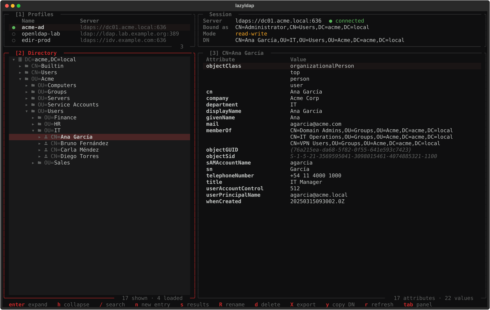
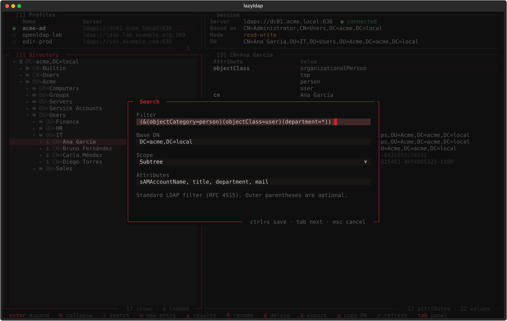
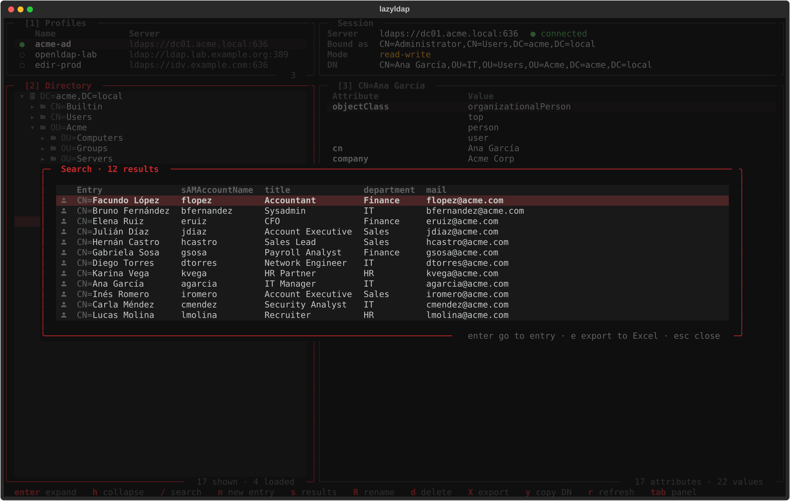
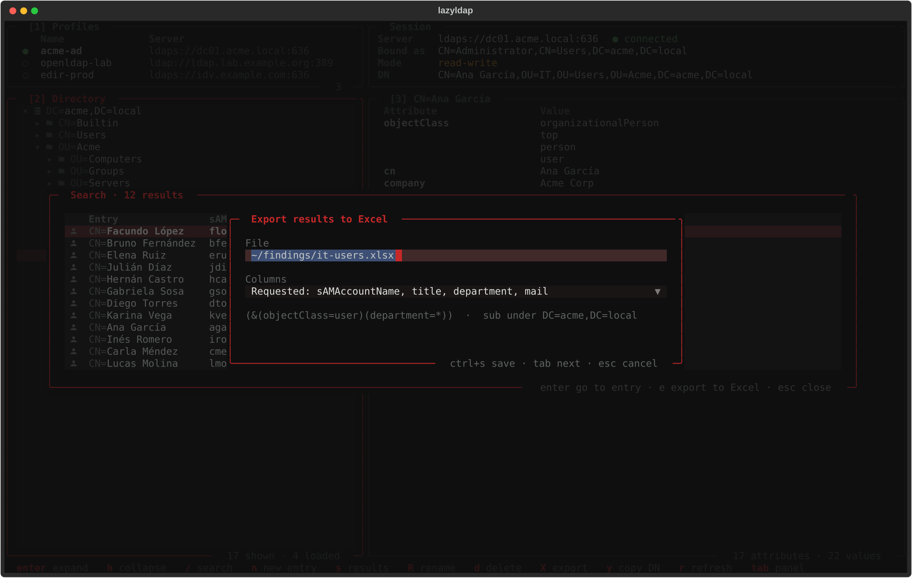
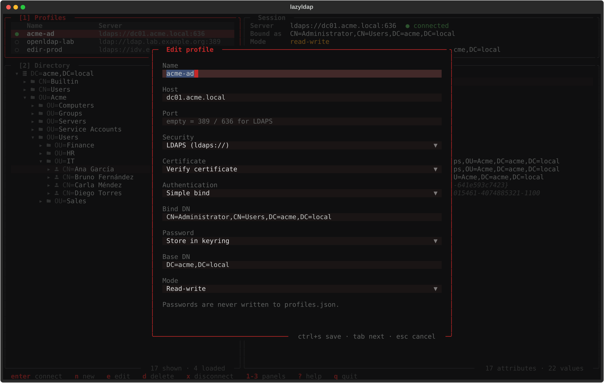

<div align="center">

<h1>lazyldap</h1>

**Un navegador LDAP para la terminal.**<br>
Perfiles, árbol del directorio, búsquedas con filtros LDAP estándar y export a Excel o LDIF.<br>
Active Directory, OpenLDAP, eDirectory y cualquier servidor LDAPv3.

<sub>por <a href="https://github.com/D4rkDr4gon">D4rkDr4gon</a> · MIT</sub>

<br><br>



</div>

---

lazyldap es un LDAP browser al estilo de **Softerra LDAP Browser** pero en la terminal, con la forma de
[lazygit](https://github.com/jesseduffield/lazygit): paneles numerados, todo con el teclado y sin salir de la
consola (sirve por SSH). Hecho en Python con [Textual](https://textual.textualize.io/) y
[ldap3](https://github.com/cannatag/ldap3).

## Qué hace

- **Perfiles de conexión**: host, puerto, LDAP / **LDAPS** / **StartTLS**, verificación de certificado, bind
  simple o anónimo, base DN (o los *naming contexts* del servidor) y modo **solo lectura** o lectura-escritura.
- **Login seguro**: la contraseña se pide al conectar o queda en el **keyring** del sistema (libsecret). Nunca se
  escribe en disco.
- **Árbol del directorio** que se carga por niveles (con paginado), íconos por tipo de entrada (usuarios, grupos,
  OUs, equipos).
- **Atributos** de cada entrada, con los valores binarios de AD legibles (`objectGUID`, `objectSid`, fechas) y
  los atributos operacionales a una tecla.
- **Búsquedas con la misma sintaxis que Softerra**: filtro LDAP estándar (RFC 4515), base DN, alcance y
  atributos a mostrar como columnas.
- **Export a Excel** (`.xlsx`) de los resultados de una búsqueda o de un subárbol, y **export a LDIF**.
- **Edición** (con perfiles read-write): editar, agregar y borrar valores, crear entradas pidiendo los atributos
  obligatorios del esquema, renombrar, mover y borrar. Cambio de contraseña de AD (`unicodePwd`) incluido.
- **Log de la sesión**: cada bind, listado, lectura, búsqueda y escritura con su resultado.
- Recuerda el último perfil, la última entrada abierta y la última búsqueda de cada perfil.
- **Modo demo** con un Active Directory falso para probarlo sin servidor.

## Probalo sin servidor

```sh
lazyldap --demo
```

Abre un AD de ejemplo (`DC=acme,DC=local`) con usuarios, grupos, equipos y cuentas de servicio, conectado en
modo read-write. No toca tus perfiles ni tu configuración.

## Instalación

Requiere Python 3.10+ y una terminal con una [Nerd Font](https://www.nerdfonts.com/) (para los íconos).

```sh
# con pipx (recomendado)
pipx install git+https://github.com/D4rkDr4gon/lazyldap

# o con pip
pip install --user git+https://github.com/D4rkDr4gon/lazyldap
```

En **Arch Linux** las dependencias están en los repos oficiales, así que se puede correr directo desde el clon:

```sh
sudo pacman -S python-textual python-ldap3
git clone https://github.com/D4rkDr4gon/lazyldap
cd lazyldap && PYTHONPATH=src python -m lazyldap
```

Opcionales: `secret-tool` (paquete `libsecret`) para guardar contraseñas en el keyring, y `wl-copy` / `xclip`
para copiar al portapapeles.

## Uso

```sh
lazyldap              # abre en la lista de perfiles
lazyldap work-ad      # conecta a ese perfil al arrancar
lazyldap --demo       # Active Directory de ejemplo
```

1. `n` en **Profiles** para crear un perfil.
2. `enter` para conectar: pide la contraseña (o la toma del keyring).
3. Navegá el árbol con `j`/`k` y `enter` / `l` / `h`; los atributos se ven a la derecha.
4. `/` para buscar, `e` en los resultados para exportarlos a Excel.

### Atajos

| Tecla | Profiles | Directory | Entry |
|---|---|---|---|
| `enter` | conectar | expandir / colapsar | ver el valor completo |
| `l` `→` / `h` `←` | | expandir / colapsar o subir al padre | |
| `/` | | buscar | buscar |
| `s` | | reabrir los últimos resultados | reabrir los últimos resultados |
| `n` | nuevo perfil | nueva entrada hija | |
| `e` | editar perfil | renombrar / mover | editar valor |
| `a` | | agregar valor | agregar valor o atributo |
| `d` | borrar perfil | borrar entrada | borrar valor |
| `X` | | exportar (LDIF o Excel) | exportar la entrada |
| `y` / `Y` | | copiar DN | copiar valor / copiar DN |
| `o` | | | atributos operacionales |
| `r` | releer perfiles | refrescar nodo | releer entrada |
| `L` | | log de la sesión | log de la sesión |
| `x` | desconectar | desconectar | desconectar |

`1` `2` `3` o `tab` cambian de panel, `?` muestra la ayuda, `q` sale.

## Búsquedas



El formulario es el de Softerra: **Filter**, **Base DN**, **Scope** (subtree, one level, base) y
**Attributes**. El filtro es LDAP estándar y va tal cual al servidor; si te olvidás los paréntesis exteriores
(`objectClass=user`) se agregan solos.

```text
(&(objectCategory=person)(objectClass=user)(sAMAccountName=jdo*))
(&(objectClass=user)(userAccountControl:1.2.840.113556.1.4.803:=2))          # cuentas de AD deshabilitadas
(memberOf:1.2.840.113556.1.4.1941:=CN=VPN Users,OU=Groups,DC=acme,DC=local)  # miembros, con grupos anidados
(&(objectClass=user)(whenCreated>=20260101000000.0Z))                        # creados este año
(&(objectClass=inetOrgPerson)(mail=*@example.com))                           # OpenLDAP / eDirectory
```

Los atributos que pongas en **Attributes** (`sAMAccountName, title, department, mail`) se muestran como
columnas. `enter` sobre un resultado abre el árbol hasta esa entrada.



## Export a Excel y LDIF

En la lista de resultados, `e` exporta **todos** los resultados de la búsqueda (no solo los de la pantalla) a una
planilla `.xlsx`:

- hoja **Results**: una fila por entrada, el DN y una columna por atributo (los pedidos, o todos); los
  multivaluados van uno por línea dentro de la celda;
- hoja **Search**: servidor, usuario, base, filtro, alcance, cantidad y fecha. Queda el registro de qué se buscó.

Encabezado fijo, autofiltro y todo como texto (un DN o un teléfono no se convierten en números). El `.xlsx` se
genera sin dependencias extra.



`X` sobre el árbol exporta la entrada o todo el subárbol a **LDIF** o a **Excel**.

## Perfiles y contraseñas



Los perfiles se guardan en `~/.config/lazyldap/profiles.json` (permisos `600`) y **nunca** llevan contraseñas.
Con *Password: Store in keyring* la contraseña se guarda con `secret-tool` después del primer login correcto; si
después el servidor la rechaza, la vuelve a pedir y la reemplaza.

**Read-only** es el modo por defecto: la conexión se abre en solo lectura y la TUI bloquea cualquier edición.
Para producción, dejalo así.

| Archivo | Qué guarda |
|---|---|
| `~/.config/lazyldap/profiles.json` | Perfiles (`LAZYLDAP_CONF` para usar otro) |
| `~/.config/lazyldap/theme.json` | Colores (`LAZYLDAP_THEME` para usar otro) |
| `~/.config/lazyldap/keymap.json` | Teclas reasignadas (`LAZYLDAP_KEYMAP`) |
| `~/.local/state/lazyldap/state.json` | Último perfil, última entrada y última búsqueda (`LAZYLDAP_STATE`) |

## Colores y teclas

El tema por defecto es rojo sobre negro. Para cambiarlo, un `theme.json` con cualquiera de estas claves:

```json
{
  "primary": "#7aa2f7", "secondary": "#3d59a1",
  "background": "#1a1b26", "foreground": "#c0caf5",
  "chip_battery": "#1f2335", "chip_bluetooth": "#24283b", "chip_wlan": "#292e42", "chip_audio": "#343a55",
  "status_ok": "#9ece6a", "status_warn": "#e0af68", "status_error": "#f7768e"
}
```

`primary` es el acento (bordes con foco, atajos), `chip_*` es una rampa de superficies de oscuro a claro
(campos, filas seleccionadas) y `status_*` los estados. Si ya tenés un JSON de colores de tu entorno con esas
claves, apuntá `LAZYLDAP_THEME` a él y lazyldap sigue tu tema.

Cualquier tecla se puede reasignar en `keymap.json` usando el id que muestra la ayuda (`?`):

```json
{ "LazyLdapView.search": "f", "LazyLdapView.export": "ctrl+e" }
```

## Desarrollo

```sh
git clone https://github.com/D4rkDr4gon/lazyldap && cd lazyldap
PYTHONPATH=src python -m unittest discover -s tests -v   # tests (usan el AD falso del modo demo)
PYTHONPATH=src python scripts/screenshots.py               # regenera las capturas del README
```

| Archivo | Qué es |
|---|---|
| `src/lazyldap/app.py` | La TUI (paneles, acciones, workers) |
| `src/lazyldap/core.py` | Backend sin interfaz: perfiles, keyring, sesión LDAP, LDIF |
| `src/lazyldap/ui.py` | Piezas de interfaz (paneles, tablas, popups, tema) |
| `src/lazyldap/xlsx.py` | Escritor de `.xlsx` sin dependencias |
| `src/lazyldap/demo.py` | El Active Directory falso de `--demo` |

Toda operación LDAP corre en un hilo aparte con un lock sobre la conexión, así la interfaz no se traba con un
servidor lento. El modo demo usa el servidor simulado de ldap3 con el esquema de Windows Server 2012 R2; ese
simulador no evalúa las reglas de coincidencia extendidas (los filtros con OID), un AD real sí.

## Licencia

[MIT](LICENSE)
